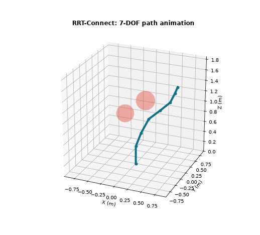
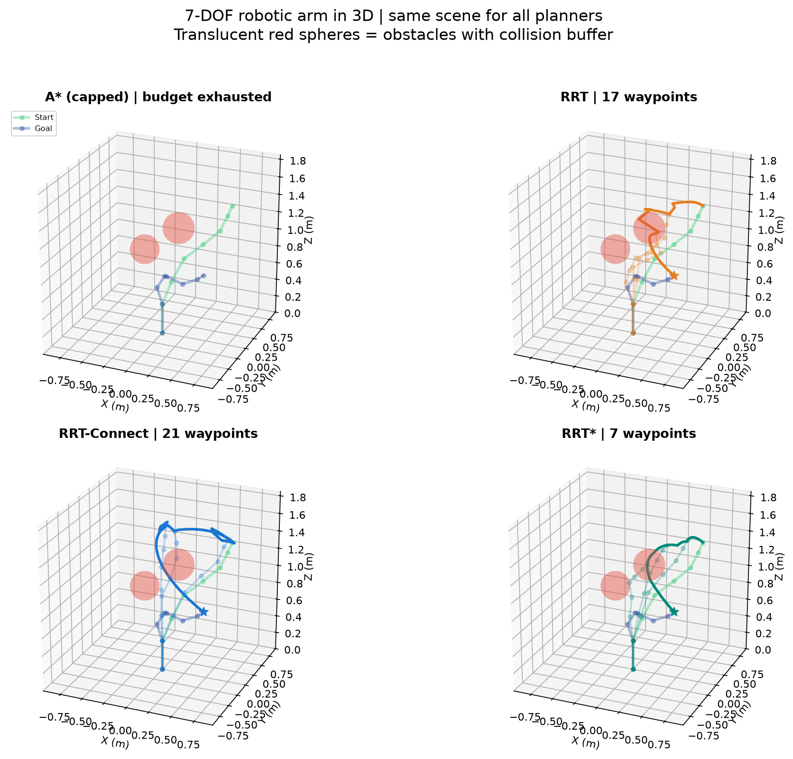
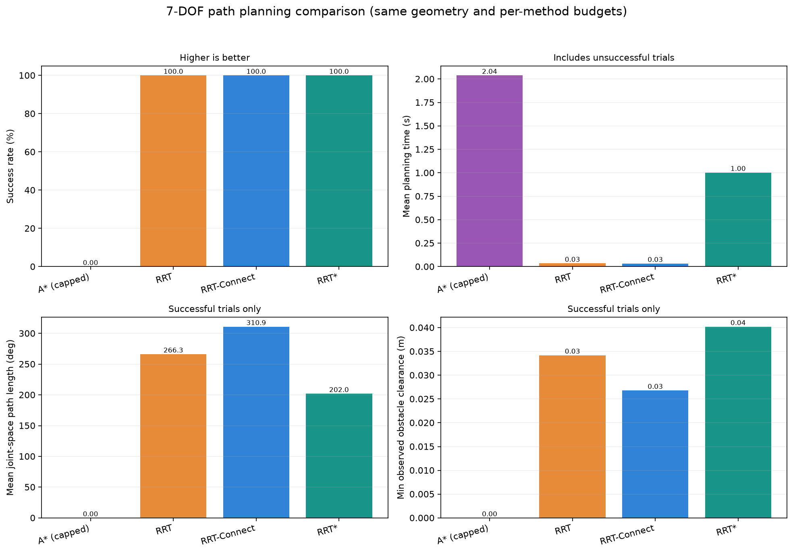

# 3D robotic arm path planning — 7 degrees of freedom

An **independently implemented 3D and 7-DOF educational simulation** comparing **A\***, **RRT**, **RRT\*** and **bidirectional RRT-Connect** for a *7-revolute-joint robotic arm in three-dimensional workspace*.

**Scope:** This repository contains an independent educational implementation. It is not a physical-robot controller.

## View the 3D simulation

The Python simulation generates a 7-joint robotic arm motion GIF and comparison images. GitHub can display them directly in this README (after the generation workflow finishes).



**[Open animation GIF](results/arm_motion_3d.gif)** | **[3D path-planning visualization](results/arm_3d_paths.png)** | **[Algorithm comparison charts](results/planner_comparison.png)**





To regenerate the simulation on your laptop:

```powershell
pip install -r requirements.txt
python run_7dof.py --gif
```

The GitHub Actions workflow `.github/workflows/generate-simulation.yml` can also regenerate and commit these visuals.

## What's implemented

- Seven **revolute joints** (7 joint variables, in radians internally), with local rotational axes `z, y, x, y, x, y, x`, joint limits and configurable link lengths.
- **Actual 3D forward kinematics:** each pose generates 8 3D points for the base, 7 links and the end-effector.
- **Entire-arm collision checking:** each finite-radius link capsule is tested against spherical obstacles **and every non-adjacent link pair** to detect self-intersection. A configurable safety margin is enforced.
- **Full 7-dimensional joint-space planning:** budget-limited A* lattice, RRT, RRT-Connect and RRT*.
- Motion paths are checked at interpolated joint configurations, not merely at endpoints.
- Per-trial and aggregated metrics: success rate, planning time, waypoint count, joint-space path length, *end-effector travel distance* and observed obstacle clearance.
- Plotting: 3D arm paths plus four comparison charts; optional **animated 3D GIF** with quintic position timing.
- CSV outputs with every saved joint angle so you can plot them and use data in a presentation.

**NOT a particular industrial robot:** the 7-DOF robot is a configurable illustrative serial chain. Its dimensions, joint axes and limits are *not* calibrated URDF or DH parameters for Panda, KUKA LBR iiwa or another real model. There is **no torque, dynamics, gravity, actuator-velocity, or physically validated controller model**.

## Run on Windows (Python 3.9+)

In PowerShell or CMD (from the extracted folder):

```powershell
python -m venv .venv
.venv\Scripts\activate
pip install -r requirements.txt
python run_7dof.py
```

Quick 3D GIF:

```powershell
python run_7dof.py --gif
```

Change number of trials, sampling iterations or planning methods:

```powershell
python run_7dof.py --trials 10 --iterations 2500 --astar-limit 3000
python run_7dof.py --methods rrt rrt_connect rrt_star --trials 5 --shortcut
python -m unittest discover -s tests -v
```

The generated outputs are in `results/`:

| File | Content |
|---|---|
| `arm_3d_paths.png` | Four 3D panels showing start, goal, obstacles, arm poses and end-effector paths |
| `planner_comparison.png` | Success, runtime, joint-length and clearance plots |
| `arm_motion_3d.gif` | Optional 7-DOF animation (`--gif`) |
| `trials.csv` | Every run's results; failures are included as failures, never fabricated |
| `summary.csv` | Aggregated per-method statistics |
| `experiment_config.json` | Geometry, limits, search budgets and seeds |
| `path_<method>_deg.csv` | 7 joint-angle columns for one successful path of each method |

## Example benchmark

With `python run_7dof.py --trials 3 --iterations 1500 --astar-limit 450`, sampled self-collision checking ON, two static 3D spheres, two fixed joint configurations, RNG seed 7:

| Planner | Successes | Mean runtime (s) | Mean joint-space path (deg) | Mean observed obstacle clearance (m) |
|---|---:|---:|---:|---:|
| A* (capped) | 0/3 | 1.50 | — | — |
| RRT | 3/3 | 0.026 | 266.28 | 0.0342 |
| RRT-Connect | 3/3 | 0.026 | 310.88 | 0.0268 |
| RRT* | 3/3 | 0.792 | 201.96 | 0.0402 |

Numbers are illustrative measurements from one Python environment; planning times depend strongly on hardware and may vary. **Three trials are insufficient for a scientific performance claim.** Repeat with 30+ trials, vary obstacle scenes and test different difficulty levels for a stronger academic comparison. RRT* often improves joint path length but can cost more planning time. Under this budget, A* ran out of expansions; that is **not** proof that A* is mathematically incapable of solving 7-DOF planning.

### Why A* struggles with 7 joints

With 12 discretized angle values per joint, a full dense joint-space grid has **12⁷ = 35,831,808 states** even before adding collision checks and neighbor edges. This code uses lazy, budgeted, axis-neighbor A* rather than constructing the whole grid. It is explicitly **not** claimed to be globally complete or optimal.

### What a "3D 7-DOF" planner means

- Workspace: 3D, with x/y/z in **metres**. Robot geometry and spheres are drawn in that space.
- Configuration space: 7D, containing angles **q1...q7**. Tree/lattice planners operate in this space, not by simply joining Cartesian end-effector points.
- Kinematics: `p_(i+1) = p_i + L_i R_i [0,0,1]^T` with cumulative `R_i = R_(i-1) Rot(axis_i, q_i)`.
- Segment-to-sphere collision: minimum distance from a **3D line segment** to sphere centre minus sphere and link radii. Must exceed a safety margin.
- Self collision: distances between **non-adjacent** capsule links are also checked.
- **Observed** clearance means the minimum distance over the *sampled* path. It is not a certified lower bound for continuously evolving motion.

## Known limitations and assumptions

1. Static spherical obstacles only, not arbitrary meshes, cuboids or robot base collisions.
2. Self-collision uses simplified capsules; adjacent-link actuator housings, tool shape and gripper are not modelled.
3. Motion/edge collision checking is **sampled** (max angle change 0.055 radians per joint), not exact continuous collision detection. Lower the step for higher confidence, and separately validate before real hardware use.
4. RRT* uses a **fixed neighborhood radius**, so textbook asymptotic-optimality guarantees do not necessarily apply to this implementation.
5. Joint-space distance uses unweighted Euclidean radians; speed limits, acceleration limits, torque and dynamics not enforced. The GIF's quintic timing is illustrative, not time-optimal.
6. A* is budgeted and uses coarse, axis-aligned neighbors; it can fail to find existing solutions.
7. Start and goal are **joint configurations**, not solved from a requested Cartesian tool pose. Inverse kinematics is a logical next phase.

## Structure

```text
robotic_arm_3d_7dof/
├── robot7dof.py                  # 3D FK, link-vs-sphere and self-collision
├── planners.py                   # A*, RRT, RRT-Connect, RRT*, metrics
├── test_scenes.py                # baseline scene and joint configurations
├── run_7dof.py                  # CLI experiments, CSV, plots, GIF
├── tests/test_motion.py          # deterministic validation tests
├── results/                      # sample output images and tables
├── requirements.txt
└── README.md
```

## Research references

- S. M. LaValle, *Rapidly-exploring random trees: A new tool for path planning*, 1998.
- S. Karaman and E. Frazzoli, *Sampling-based algorithms for optimal motion planning*, IJRR 2011.
- Hart, Nilsson and Raphael, *A formal basis for the heuristic determination of minimum cost paths*, 1968.

**Use in class:** show `arm_3d_paths.png`, `planner_comparison.png` and (optional) `arm_motion_3d.gif`; explain 7D vs 3D, collision along whole links, and differences between speed, path length and success rate. Avoid claiming experiments on a physical robot or a specific industrial manipulator.