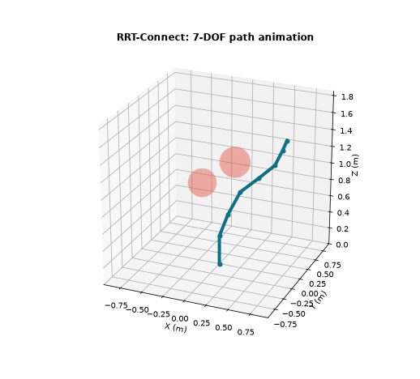

# 3D simulation outputs

This folder contains results from the **7-DOF 3D robotic-arm path-planning simulation**. GitHub can show the generated animation and charts directly:

- **[Animated 3D robot (GIF)](arm_motion_3d.gif)** — planned arm motion with obstacles
- **[3D planner comparison](arm_3d_paths.png)** — A*, RRT, RRT-Connect and RRT* scenes
- **[Algorithm performance plots](planner_comparison.png)** — success, planning time, path length and clearance
- **[Experiment configuration](experiment_config.json)**, **[raw trials](trials.csv)** and **[summary statistics](summary.csv)**



The example images and GIF are generated from the checked-in Python code. The GitHub Actions workflow at `.github/workflows/generate-simulation.yml` runs the tests, renders the outputs and commits the images.

To regenerate the simulation locally:

```bash
pip install -r requirements.txt
python run_7dof.py --trials 3 --iterations 1500 --astar-limit 450 --gif
```

**Scope:** this is a software simulation of an illustrative 7-revolute-joint robot, not a physical robot controller. Runtime values are hardware-dependent; rerun benchmarks for your own measurements.
